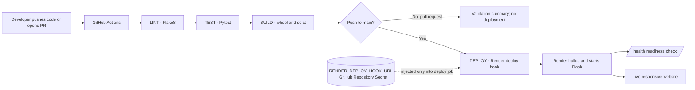

# CI/CD Pipeline – Continuous Deployment & Secrets Management

A beginner-friendly project that demonstrates how to move a Python Flask application from a code change to a checked, packaged, and deployed web service. GitHub Actions runs Flake8, Pytest, and a Python package build in separate jobs. Only a successful push to `main` can trigger a Render deployment.

> **Live application:** `https://YOUR-SERVICE-NAME.onrender.com` (replace this placeholder after deployment)

## Problem statement

Manual releases can skip checks, package inconsistent files, and expose credentials when a deployment URL is copied into source code. This project automates repeatable checks and keeps the Render deployment credential in GitHub Repository Secrets.

## Objectives

- Build a responsive Flask website with a homepage, a health check, and a JSON status API.
- Run Flake8, Pytest, and a wheel/source archive build in GitHub Actions.
- Require lint, tests, and build to pass before the deploy job can run.
- Deploy only on a push to `main`; pull requests run validation only.
- Store the Render Deploy Hook URL in GitHub Actions secrets and keep it out of source and logs.
- Explain setup, troubleshooting, deployment verification, and rollback in beginner-friendly steps.

## Technology stack

| Area | Technology |
| --- | --- |
| Application | Python 3.12, Flask, HTML, CSS, JavaScript |
| Quality checks | Flake8, Pytest |
| CI/CD | GitHub Actions |
| Package build | Python `build`, setuptools, wheel |
| Hosting | Render Python web service, Gunicorn |
| Credentials | GitHub Repository Secret |

## Architecture



The `test` job has `needs: lint`, `build` has `needs: test`, and `deploy` has `needs: [lint, test, build]`. GitHub skips a dependent job if an upstream job fails. Render Auto-Deploy is disabled in `render.yaml`, so pushing to GitHub alone does not bypass the checks.

## Project structure

```text
ci-cd-pipeline-secrets-management/
├── .github/
│   └── workflows/
│       └── ci-cd.yml
├── app/
│   ├── __init__.py
│   ├── main.py
│   ├── static/
│   │   ├── app.js
│   │   └── style.css
│   └── templates/
│       └── index.html
├── tests/
│   └── test_app.py
├── .flake8
├── .gitignore
├── .python-version
├── pyproject.toml
├── render.yaml
├── requirements-dev.txt
├── requirements.txt
├── README.md
└── wsgi.py
```

## Run the project locally (Windows PowerShell)

Install Python 3.12 and Git first. In PowerShell, move into this project folder (adjust the parent folder if you placed it elsewhere):

```powershell
cd "C:\Users\Admin\OneDrive\Desktop\mani\resume1 project\ci-cd-pipeline-secrets-management"
py -3.12 --version
py -3.12 -m venv .venv
```

Activate the environment and install the application plus development tools:

```powershell
.\.venv\Scripts\Activate.ps1
python -m pip install --upgrade pip
python -m pip install -r requirements-dev.txt
```

If PowerShell says script execution is disabled, you can allow locally created scripts for your Windows user with `Set-ExecutionPolicy -ExecutionPolicy RemoteSigned -Scope CurrentUser`, then activate again. Alternatively, run commands without activation by calling `.\.venv\Scripts\python.exe` directly.

Start the Flask development server:

```powershell
flask --app wsgi run --debug
```

Open `http://127.0.0.1:5000/` in a browser. Stop the local server with **Ctrl+C**. The debug server is for local development; Render runs the app using Gunicorn.

### Check the endpoints locally

In a second PowerShell window, run:

```powershell
Invoke-RestMethod http://127.0.0.1:5000/health | ConvertTo-Json
Invoke-RestMethod http://127.0.0.1:5000/api/status | ConvertTo-Json
```

`/health` should return `status: healthy`. `/api/status` reports the app environment, version, and a short commit ID when Render supplies one. These endpoints contain no deployment credentials.

### Run the same checks as the pipeline

From the activated virtual environment:

```powershell
python -m flake8 app tests wsgi.py
python -m pytest
python -m build --sdist --wheel --outdir dist
Get-ChildItem dist
```

Flake8 exits with code `0` when it finds no configured style violations. Pytest prints the test results. The final command should produce one `.whl` and one `.tar.gz` distribution. No test or deployment result is assumed by this README; run these commands to see the result for your machine and commit.

## GitHub setup

### 1. Create a repository

On GitHub, create a new repository, for example `ci-cd-pipeline-secrets-management`. If you are following the commands below, create it **without** a README, license, or `.gitignore` so the remote starts empty.

### 2. Initialize and push from PowerShell

Run these commands from the project folder. Replace `YOUR-USERNAME` and `YOUR-REPOSITORY` with your GitHub values:

```powershell
cd "C:\Users\Admin\OneDrive\Desktop\mani\resume1 project\ci-cd-pipeline-secrets-management"
git init -b main
git add .
git status
git commit -m "Build Flask CI/CD pipeline project"
git remote add origin https://github.com/YOUR-USERNAME/YOUR-REPOSITORY.git
git push -u origin main
```

Git may ask you to sign in through a browser. Use Git Credential Manager or GitHub CLI (`gh auth login`); GitHub account passwords are not accepted as Git HTTPS passwords. Keep authentication tokens private.

If `git remote add origin` says `remote origin already exists`, inspect it and correct its URL:

```powershell
git remote -v
git remote set-url origin https://github.com/YOUR-USERNAME/YOUR-REPOSITORY.git
git push -u origin main
```

### Common Git errors

| Error | What to check / fix |
| --- | --- |
| `src refspec main does not match any` | Run `git status`; add files and create the first commit, then confirm the branch with `git branch --show-current`. |
| `Author identity unknown` | Set your commit identity: `git config --global user.name "Your Name"` and `git config --global user.email "you@example.com"`, then retry the commit. |
| `remote origin already exists` | Use `git remote -v`; fix the URL with `git remote set-url origin <repository-url>`. |
| `rejected ... fetch first` | If you created a GitHub starter commit, merge it with `git pull --no-rebase --allow-unrelated-histories origin main`. If Git reports conflicts, edit the listed files to resolve the conflict markers, then run `git add .`, `git commit -m "Merge GitHub starter files"`, and `git push -u origin main`. Do not force-push over work you need. |
| `Permission denied` or authentication failure | Confirm the remote URL, sign in with Git Credential Manager or `gh auth login`, and check that your GitHub account can write to the repository. |

After the push, open the repository's **Actions** tab. The workflow runs automatically for pushes to `main` and pull requests targeting `main`.

## GitHub Actions workflow

Workflow file: `.github/workflows/ci-cd.yml`.

| Job | Runs when | Work |
| --- | --- | --- |
| `lint` | Push to `main` or PR targeting `main` | Installs dev requirements and runs `python -m flake8 app tests wsgi.py`. |
| `test` | Only after `lint` succeeds | Runs the Flask app tests with Pytest. |
| `build` | Only after `test` succeeds | Builds a wheel and source archive, then saves both as a GitHub Actions artifact. |
| `deploy` | Only after lint, test, and build succeed **and** event is a push to `main` | Sends a POST request to the Render Deploy Hook URL from the repository secret. |
| `summary` | Always, including when a previous job fails or is skipped | Adds each job result and deployment guidance to the GitHub Actions run summary. |

The deploy job has the required `needs: [lint, test, build]` dependency and the explicit condition `push` + `refs/heads/main`. A pull request therefore receives checks but cannot start a production deployment. The workflow grants only `contents: read` to `GITHUB_TOKEN`.

## Secrets management

The only deployment credential is the Render Deploy Hook URL. GitHub encrypts repository secrets and makes them available to a workflow only when the workflow explicitly references them. The workflow maps the secret to the deploy job's `RENDER_DEPLOY_HOOK_URL` environment variable. It never prints the URL. GitHub also withholds repository secrets from workflows triggered by pull requests from forks.

### Add `RENDER_DEPLOY_HOOK_URL` in GitHub

1. Open your repository on GitHub.
2. Select **Settings → Secrets and variables → Actions**.
3. Select **New repository secret**.
4. Enter the exact name `RENDER_DEPLOY_HOOK_URL`.
5. Paste the Deploy Hook URL copied from Render into the value field, then save.
6. Do not add the URL to source code, README files, screenshots, issue comments, or command output.

If the secret is missing, the deploy job stops with a message naming the missing secret (without displaying a value). To update it later, return to the same page and edit the secret.

### Rotate an exposed deploy hook

1. In Render, open the web service's **Settings** and regenerate its Deploy Hook. Regeneration invalidates the old URL.
2. In GitHub, edit the `RENDER_DEPLOY_HOOK_URL` repository secret and replace its value with the new URL.
3. If the old URL was committed, remove it from the source and history as appropriate, but treat it as compromised until regenerated; deleting a line or repository alone does not invalidate it.
4. Run a new push to `main` or rerun the workflow to confirm the new secret works. Check the deploy job and Render's Deploys page.

Do not paste the hook value into a terminal command that will be saved in shell history. GitHub's secret masking helps protect logs, but it is not a reason to print or disclose the value.

## Deploy to Render

The project includes `render.yaml`. Its deployment settings are:

```text
Runtime: Python
Branch: main
Python version: 3.12 (from .python-version)
Build command: pip install -r requirements.txt
Start command: gunicorn wsgi
Health check path: /health
Auto-deploy: off
```

### Create and configure the Render Web Service

1. Push this project to GitHub as described above.
2. Sign in to Render and choose **New → Web Service**.
3. Connect GitHub if asked, then select the project repository.
4. Set the branch to `main` and the runtime to **Python**. Choose a compute plan available to your Render account. If Render offers a Blueprint configuration from `render.yaml`, use it; otherwise enter the values in the table above manually.
5. Set the build command to `pip install -r requirements.txt` and the start command to `gunicorn wsgi`.
6. Set the health check path to `/health`. Keep `APP_ENV=production` if entering environment variables manually; the Blueprint already sets it.
7. Set **Auto-Deploy** to **Off**. The Blueprint sets `autoDeployTrigger: off`; confirm the dashboard also shows deploys are controlled by the workflow.
8. Create the service. Render performs its initial service setup. Once the hook and GitHub secret are configured, subsequent production deploys are requested by the Actions workflow.

Render's Auto-Deploy must be off for this project. Otherwise a Git push could trigger a Render deployment separately from the required Actions gates.

### Create the Render Deploy Hook

1. Open the Render service and go to **Settings**.
2. Find **Deploy Hook** and create a hook for the service (use a name such as `github-actions`).
3. Copy the generated URL and immediately save it as the GitHub repository secret `RENDER_DEPLOY_HOOK_URL` using the steps above.
4. Treat the hook URL like a password: anyone who has it can request a deployment. If it is exposed, regenerate it in Render and update the GitHub secret.

### Verify a deployment

1. Confirm lint, test, and build succeeded in the GitHub Actions run for the push to `main`.
2. Confirm the deploy job reports that Render accepted the request. This means the hook request succeeded; Render still needs to finish its own build and health check.
3. In Render, open the service's **Events** or **Deploys** page and wait until the deployment is marked live/successful. Read the deploy logs if it fails.
4. Open the Render service URL shown in its dashboard and confirm the homepage loads.
5. Visit `https://YOUR-SERVICE-NAME.onrender.com/health` and confirm it returns HTTP 200 with `{"status":"healthy"}`.
6. Visit `https://YOUR-SERVICE-NAME.onrender.com/api/status` and confirm it returns JSON with `status` set to `operational` and `environment` set to `production`.
7. Replace the live URL placeholder near the top of this README with the URL shown in Render.

Render uses `/health` to decide whether a new instance is ready. If a new deployment does not pass its checks, Render cancels that deploy and keeps routing traffic to the previously healthy service instance. A successful deploy-hook request alone does not prove that the Render build finished successfully, so check Render's deployment status too.

## Failure handling and rollback

### What happens when a stage fails?

- **Lint failure:** Flake8 prints the file and line to fix. The `test`, `build`, and `deploy` jobs are skipped because they depend on the lint result.
- **Test failure:** Open the Pytest output and fix the failing assertion or application behavior. The build and deploy jobs are skipped.
- **Build failure:** Check the packaging output and `pyproject.toml`; deployment is skipped because the build did not succeed.
- **Deploy-hook failure:** The deploy job fails if the secret is absent, the hook request is rejected, or the request times out. Check that the Render hook is current, the secret name is exact, and the service is available. Do not paste the secret into logs when troubleshooting.
- **Render build/start/health failure after hook acceptance:** The Actions deploy job may already be green because the hook accepted the request. Check the Render Events/Deploys page and logs. Render cancels a failed new deploy and continues serving the previous healthy deployment.

The `summary` job writes lint, test, build, and deploy outcomes to the run's **Summary** page. A skipped deploy on a pull request is expected. Open the failing job for detailed output.

### Manually roll back to a previously successful deployment

1. Open the Render service and go to **Deploys**.
2. Identify the previous deployment marked live/successful, noting its commit ID.
3. Use Render's manual deploy action to deploy that previous successful commit (the exact menu label can vary as Render updates its dashboard).
4. Wait for its health check to pass, then verify `/health` and the homepage.
5. Fix the faulty code on a branch, open a pull request, and let the normal pipeline validate the correction before merging it to `main`.

If Render has already kept the old healthy instance after a failed deploy, a manual rollback may not be needed. Record the incident and confirm the live version before making another change.

## Screenshots

Add screenshots after running locally or deploying. Suggested captures: the responsive homepage, a successful Actions run with the four stages, and the Render service marked live. Store images in a `docs/screenshots/` folder and link them here. Do not include the Deploy Hook URL, secret settings, or other credentials in screenshots.

<!-- Example after adding an image:  -->

## Final submission checklist

- [ ] Flask homepage, `/health`, and `/api/status` work locally.
- [ ] `python -m flake8 app tests wsgi.py` completes successfully.
- [ ] `python -m pytest` completes successfully.
- [ ] `python -m build --sdist --wheel --outdir dist` creates the wheel and source archive.
- [ ] Project is pushed to the GitHub repository's `main` branch.
- [ ] GitHub Actions shows the lint, test, and build jobs passing.
- [ ] Render Web Service uses the specified build/start commands and `/health` check.
- [ ] Render Auto-Deploy is off.
- [ ] `RENDER_DEPLOY_HOOK_URL` exists as a GitHub Repository Secret and is absent from committed files.
- [ ] A push to `main` triggers the Render deployment only after all required jobs pass.
- [ ] Live homepage, `/health`, and `/api/status` are verified.
- [ ] README live URL is updated and screenshots contain no credentials.

## Official references

- [GitHub Actions secrets](https://docs.github.com/en/actions/concepts/security/secrets)
- [GitHub: Using secrets in Actions workflows](https://docs.github.com/en/actions/how-tos/write-workflows/choose-what-workflows-do/use-secrets)
- [Render Deploy Hooks](https://render.com/docs/deploy-hooks)
- [Render Blueprint specification](https://render.com/docs/blueprint-spec)
- [Render health checks](https://render.com/docs/health-checks)
- [Render Python versions](https://render.com/docs/python-version)
